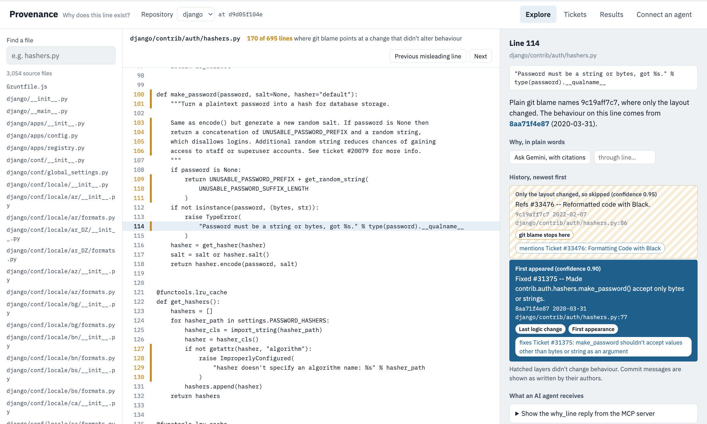
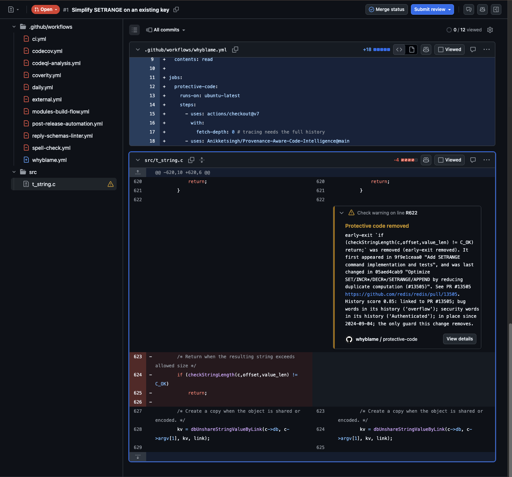

# whyblame

<!-- mcp-name: io.github.Anikketsingh/whyblame -->

**`git blame` tells you who. `whyblame` tells you why.**

[PyPI](https://pypi.org/project/whyblame/) · [GitHub Marketplace](https://github.com/marketplace/actions/whyblame-protective-code-check) · [MCP registry](https://registry.modelcontextprotocol.io/v0/servers?search=whyblame) (`io.github.Anikketsingh/whyblame`) · [Release notes](https://github.com/Anikketsingh/Provenance-Aware-Code-Intelligence/releases/tag/v1.0.0)

`git blame` names the last commit that touched a line, and that is often a reformat, a rename or a move. `whyblame` traces the line back past those to the change that really gave it its behaviour, and attaches the ticket or pull request that explains it. It answers you in the terminal and a local web UI, and it answers AI coding agents over MCP, **before** they delete a check whose purpose they can't see.



## Quickstart (about 30 seconds)

Needs Python 3.12+ and git. Run this inside any git repository:

```bash
uv tool install whyblame           # or: pipx install whyblame, or: pip install whyblame
whyblame index                     # once per repo; later runs only add new commits
whyblame why . path/to/file.py 42  # the line's real history
```

Then give your AI agent the same answers:

```bash
whyblame init
```

`init` prints the exact command or config for Claude Code, Codex, Gemini CLI, VS Code, Cursor, LM Studio and Claude Desktop (with Claude Code it's `claude mcp add whyblame -- whyblame mcp /absolute/path/to/repo`). It also adds a short rule to `AGENTS.md`, `CLAUDE.md`, `GEMINI.md` and `.cursor/rules/`: check `why_line` before removing a guard. That rule is what makes smaller models actually call the tool. It sits between marker comments, so running `init` again changes nothing and your own text is never touched.

Any MCP client works with any tool-calling model, including local ones. The server runs on your machine, reads only git history, and needs no API key. It speaks stdio by default; `whyblame mcp --http` serves Streamable HTTP at `http://127.0.0.1:8766/mcp` for clients that take a URL. Every reply is plain JSON with a `schema_version`, stays under about 5,000 tokens (saying what was cut, if anything), and reports failures as a `status`, never a stack trace.

## What the agent gets

| Tool | What it answers |
|---|---|
| `why_line(file, line)` | The commit that set this line's behaviour, the reformats it skipped to get there, and the linked tickets and pull requests |
| `why_range(file, start, end)` | The same for a block, grouped by the commit that introduced each part |
| `check_change(base?, head?)` | Before committing: which guards your edits removed or weakened, and why they were there |
| `find_discussions(file, line)` | The tickets and pull requests behind the line. When none is linked, it searches for earlier ones, labelled "possibly unrelated". |
| `explain_line(file, line, end_line?)` | A short explanation that cites that evidence, or "not enough evidence". Offered only when a Gemini key is configured. |

**Safety:**

- Every tool is read-only.
- Commit messages and ticket text come back in fields marked untrusted, because anyone can write a commit message, including one that tries to give your agent instructions.
- Nothing is ever called "safe": finding no history only means none was found.

## Protect pull requests

`whyblame check` lists the protective code a change removes or weakens: `raise`, `assert`, early-return checks, `except` and `catch` clauses, locks, timeouts. For each, it says which commit and ticket put the code there, and how strongly history backs it. Reformatting and moving code never trigger it.

```bash
whyblame check .                         # your uncommitted edits against HEAD
whyblame check . --base main --head HEAD # a branch
```

The same check runs on every pull request as a GitHub Action. It warns on the changed line and never blocks:



```yaml
on: pull_request
permissions:
  contents: read
jobs:
  whyblame:
    runs-on: ubuntu-latest
    steps:
      - uses: actions/checkout@v7
        with:
          fetch-depth: 0
      - uses: Anikketsingh/Provenance-Aware-Code-Intelligence@v1
```

Agents get the same check through the `check_change` MCP tool: call it after editing and before committing.

## How it works

1. **Classify.** Every file change in history is parsed with tree-sitter. When the code's token stream is unchanged, the change was cosmetic (formatting, quotes, wrapping, renames, moves) and is recorded per file.
2. **Skip.** `git blame` gets each file's own list of cosmetic commits through `--ignore-revs-file`, so git's well-tested line matching does the heavy lifting.
3. **Step.** When a commit mixes a reformat with a real fix, the line is followed through that commit's diff, and the trace keeps walking back.

On a held-out test set of 60 lines from Django and Redis, this finds the right commit **83.5%** of the time, against **69.2%** for git's strongest settings (`-w -M -C -C`). It won on 20 lines and lost on 2 (McNemar p < 0.001).

## How much difference it makes

| Question | Without | With whyblame |
|---|---|---|
| Right commit for a line (held-out, weighted) | 69.2% (git's best) | **83.5%** |
| Hidden ticket found in the top 10 (1,000 Django commits) | 56.9% (message keywords) | **60.7%**; 39.6% even with the message hidden |
| Abstains when the evidence is withheld | | **10 of 10** |
| Claims backed by the evidence they cite | | **51 of 53** |
| CI warning hits a guard that later had to be restored | 0.80% (base rate) | **2.7%**, 3.3× the base rate |
| Agent keeps the guard (16-case pilot, 32 paired runs) | 16 of 32 | **22 of 32**, with as many tasks done (p = 0.031) |

Every number comes from `eval/reproduce.py`. The full results are in [eval/results/summary.md](https://github.com/Anikketsingh/Provenance-Aware-Code-Intelligence/blob/main/eval/results/summary.md), and the analysis, including where it doesn't help, is in [reports/analysis.md](https://github.com/Anikketsingh/Provenance-Aware-Code-Intelligence/blob/main/reports/analysis.md). The labels are AI labels, as stated throughout.

## More commands

```bash
whyblame index . --github               # also fetch pull requests and issues (needs GITHUB_TOKEN)
whyblame explain . src/app.py 120 128   # a cited explanation of a block (needs GEMINI_API_KEY)
whyblame search . retry timeout         # full-text search over fetched tickets and PRs
whyblame ui .                           # local web UI at http://127.0.0.1:8765
```

With a read-only `GITHUB_TOKEN`, `--github` (or `whyblame crawl-github .`) links every merged pull request to its merge commit, so the trace shows the pull request that explains a change. Crawls resume where they stopped. For `explain`, put `GEMINI_API_KEY=...` in your environment or in a `.env` file. Replies are cached in the repo's index, so asking again is free and works offline.

The index lives inside your repo's git directory (`.git/provenance/`), so nothing appears in your working tree.

---

## The research behind it

This is a B.Tech major project at Delhi Technological University, by Aniket Singh Kushwaha, Aarish and Aftab, guided by Prof. Shailender Kumar. The design is in [plans/](https://github.com/Anikketsingh/Provenance-Aware-Code-Intelligence/tree/main/plans), and the full write-up is in [reports/](https://github.com/Anikketsingh/Provenance-Aware-Code-Intelligence/tree/main/reports).

### Development setup

```bash
uv sync
uv run pytest            # Gemini is never called; `-m live` checks a real key
```

### The research corpus

The evaluation runs on pinned clones of four repos, addressed by name instead of path:

```bash
uv run provenance clone django && uv run provenance index django
uv run provenance fetch-tickets django --limit 300   # Trac tickets, 1 request a second
uv run provenance why django django/contrib/auth/hashers.py 114
uv run provenance ui                                  # every indexed corpus repo
```

`provenance` and `whyblame` are the same command. Links like `http://127.0.0.1:8765/#django:django/contrib/auth/hashers.py:114` open the UI at a line.

### Reproducing the results

```bash
uv run python eval/reproduce.py              # rescore everything that scores offline
uv run python eval/reproduce.py --full       # also rerun the label-free checks, RQ2 and RQ4
uv run python eval/reproduce.py --footprint  # also remeasure index time, RAM and latency
```

This writes `eval/results/summary.md`, and every number in it comes from a saved run. The individual checks:

```bash
uv run python eval/ignore_list_eval.py django   # compare with Django's hand-kept skip list
uv run python eval/ast_oracle.py django         # check against Python's own parser
uv run python eval/method_gap.py                # how often methods differ, plus a stress test
uv run python eval/score_gold.py --set test     # RQ1: score every method on the held-out lines
uv run python eval/retrieval_bench.py           # RQ2: find the hidden ticket
uv run python eval/explain_bench.py score       # RQ3: explanations (saved Gemini replies)
uv run python eval/protect_bench.py --split test  # RQ4: the CI check on held-out history
uv run python eval/agent_pilot.py score          # RQ5: the agent pilot (saved transcripts)
uv run python eval/footprint.py                 # RQ6: cost on a laptop
```

The final report is built from these results by `reports/final/build.py` (Word and PDF).

The labelling rules are in `eval/gold/RULES.md`. The gold labels are AI labels: Claude labelled every line, and Gemini checked them blind. The rules file says exactly how.

## Licence

Apache-2.0
