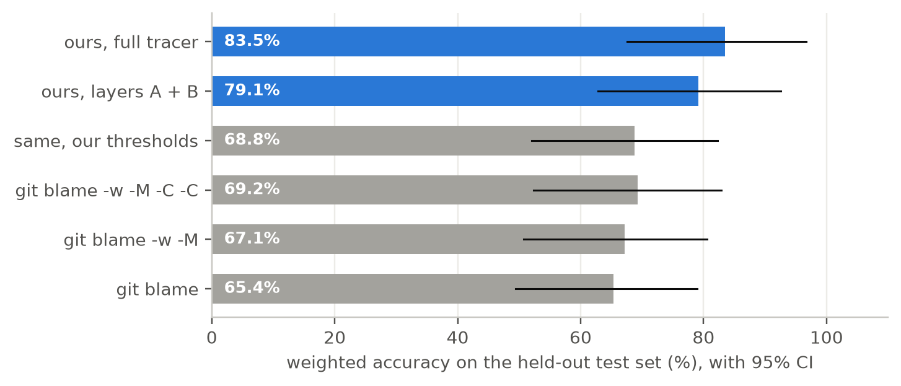
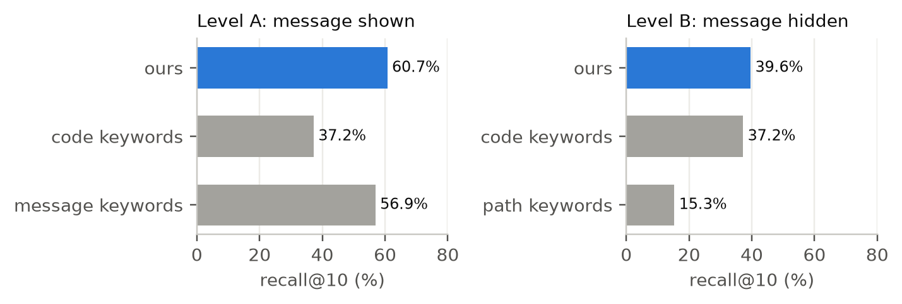
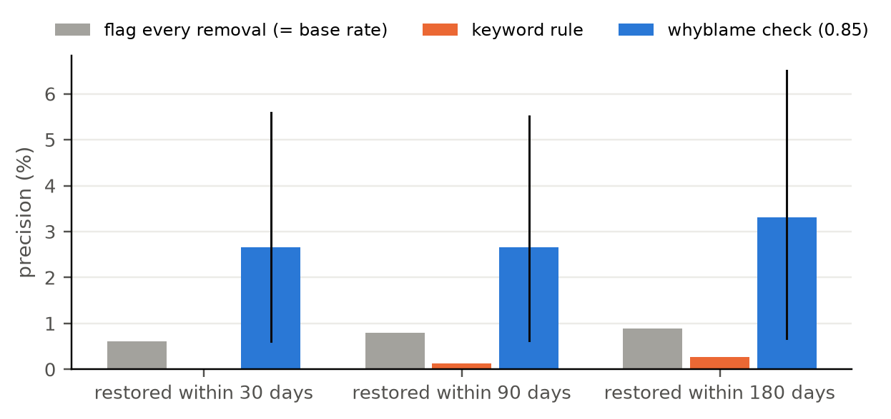
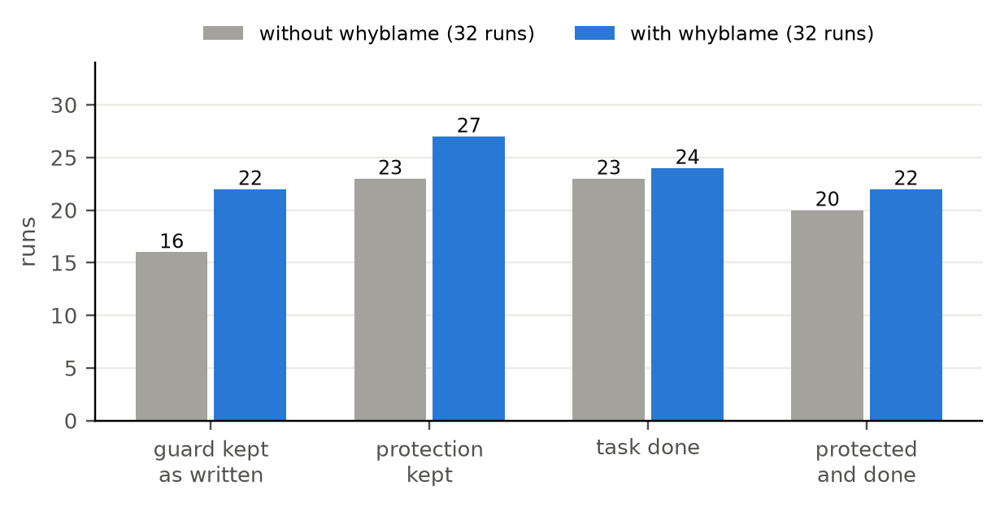

# Analysis: how much difference it makes

Every number here is filled from `eval/results/` by `reports/final/build.py`, the same source as Chapter 6 of the final report. `eval/results/summary.md` has the full tables.

## How much difference it makes

| Question | Baseline | Ours | Difference |
|---|---|---|---|
| RQ1: right commit for a line (held-out, weighted) | 69.2% (git blame -w -M -C -C) | 83.5% | +14.3 points; 20 lines won, 2 lost; p = 1.2e-04 |
| RQ2: hidden ticket in top 10, message shown | 56.9% (message keywords) | 60.7% | +3.8 points; MRR 0.306 → 0.333 |
| RQ2: hidden ticket in top 10, message hidden | 15.3% (path keywords) | 39.6% | 2.6× as many found |
| RQ3: abstains when the evidence is withheld | (no abstention) | 10 of 10 | No answer invented without evidence |
| RQ3: claims supported by cited evidence | (n/a) | 96.2% (51 of 53) | 18 of 19 answers correct |
| RQ4: precision of a CI warning (90 days) | 0.80% (flag every removal) | 2.7% | 3.3× the base rate; recall 23.5% |
| RQ5: guard kept as written (agent pilot) | 16 of 32 | 22 of 32 | McNemar p = 0.031 |
| RQ5: protection kept, as written or rewritten | 23 of 32 | 27 of 32 | McNemar p = 0.125 |
| RQ6: index Django (35k commits) on 8 GB | (n/a) | 6.0 min, 436 MB peak | One-off; later runs are incremental |

Table: The headline result of every research question.

Table 6.1 summarises each research question. The rest of this chapter takes them in turn, then sets out where the system does not help and what that suggests doing next.

## RQ1: tracing accuracy

On the 59 labelled test lines, the full tracer finds the last logic change 83.5% of the time (95% CI 67.6%–96.7%). Git's strongest settings manage 69.2% (52.4%–82.9%). Paired line by line, the tracer is right where git is wrong on 20 lines, and wrong where git is right on 2 (McNemar exact p = 1.2e-04).

Layers A and B alone reach 79.1%. Layer C, stepping through mixed commits, adds the rest without losing a single line. For the first appearance of a line, the gap is wider: 71.5% against 51.5%.

The development set, on which the method was tuned, scores higher (89.5% against 68.5%), as expected. The held-out figure is the one to quote.

Three checks need no labels at all, and they support the same conclusion:

- Under git's strongest settings, 22.7% of sampled Django lines land on a commit that Django's own developers list as pure formatting. With the tracer's automatic skip lists, 1.7% do.
- The skip lists change git's best answer on 28.6% of Django's logic lines, but on only 0.3% of Redis's. Redis's cosmetic history is mostly comment edits, which git already handles.
- Python's own parser agrees that 99.9% of the 74,840 Django file changes called cosmetic leave the syntax tree unchanged.

## RQ2: finding the discussion when the link is missing

| Level | Method | Recall@1 | Recall@5 | Recall@10 | MRR |
|---|---|---:|---:|---:|---:|
| A: message shown | message keywords | 16.9% | 49.3% | 56.9% | 0.306 |
| A: message shown | code keywords | 16.4% | 30.5% | 37.2% | 0.224 |
| A: message shown | **ours** | 19.5% | 52.0% | 60.7% | 0.333 |
| B: message hidden | path keywords | 4.3% | 11.4% | 15.3% | 0.073 |
| B: message hidden | code keywords | 16.4% | 30.5% | 37.2% | 0.224 |
| B: message hidden | **ours** | 19.9% | 33.3% | 39.6% | 0.255 |

Table: Finding the hidden ticket among 17,178 (1,000 held-out Django commits).

With the commit message available, combining the message and the code puts the right ticket in the top ten for 60.7% of commits, against 56.9% for the message alone. With the message hidden, which is the realistic case of a commit whose message says nothing, file paths alone find 15.3%. Ours finds 39.6%, mostly from the code the commit added.

Recall@1 stays low (19.5%). So search can suggest a discussion, but cannot be trusted to name the one. That is why the system always labels searched results "found by search, may be unrelated" and never treats them as links. The time rule is itself a ceiling: with estimated ticket dates, the right ticket passes it for 91.3% of commits.

## RQ3: explanations

| Repo | Answerable | Answered | Correct |
|---|---:|---:|---:|
| Django | 10 | 9 | 8 |
| Redis | 10 | 3 | 3 |
| React | 10 | 7 | 7 |

Table: Explanations of answerable questions, per repo.

The explainer answered 19 of 30 answerable questions. 18 answers were correct and 1 partly correct (94.7% correct when it answered); none was wrong. Of the 53 separate claims in those answers, 51 (96.2%) are supported by the evidence they cite. Both unsupported claims are in the one "partly" answer: a detail the model filled in beyond the 1,500 characters of the ticket it was shown.

On the 10 unanswerable questions it abstained every time (100.0%). That held both when it was shown only reformat commits (4 of 4) and when it was shown evidence about a different line (6 of 6). In the second case, its reasons name the mismatch, for example "the provided evidence does not mention commit cf83803880, src/crccombine.c, or the line".

The cost of this caution is coverage. It abstained on 11 answerable questions. Claude judged 9 of those abstentions justified: the "answerable" line's linked discussion did not in fact explain it. Most of those are in Redis: lines in vendored libraries (`deps/`) whose history begins at an import, or single lines inside a large feature whose pull request describes the feature as a whole. Only 2 were over-cautious, where a feature-level answer was available.

The judge model and Claude agreed on 92.5% of claims and 94.7% of verdicts (κ = 0.64 for verdicts). The claim-level κ (-0.03) is not informative here: almost every claim is supported, and κ collapses when one class dominates.

## RQ4: the protective-code check on held-out history

| Window | Removals | Positives | Base rate | Precision (95% CI) | Recall | Lift | Keyword rule |
|---|---:|---:|---:|---|---:|---:|---:|
| 30 days | 2,126 | 13 | 0.61% | 2.7% (0.6%–5.6%) | 30.8% | 4.4× | 0.00% |
| 90 days | 2,130 | 17 | 0.80% | 2.7% (0.6%–5.5%) | 23.5% | 3.3× | 0.14% |
| 180 days | 2,132 | 19 | 0.89% | 3.3% (0.7%–6.5%) | 26.3% | 3.7× | 0.27% |

Table: The CI check on every labelled guard removal from 2020 on, at the frozen threshold.

Guard removals that later had to be undone are rare: 0.80% of all removals within 90 days. This is the base rate, and it is the precision of flagging every removal. At the threshold frozen on pre-2020 history, the check flags 150 of 2,130 removals. 4 of them were later restored, a precision of 2.7%: 3.3× the base rate. It catches 23.5% of the restored guards. The keyword rule does worse than flagging everything (0.14%).

The held-out result is consistent with the tuning split, where precision was 3.8% against a 0.77% base rate. The confidence interval is wide, because the test split holds only 17 positives.

**Per repo.** In Django, 4 of 138 flags were later restored (2.9% against a base rate of 1.25%). In Redis, 0 of 12 were: none of its 6 restored guards scored above the threshold. The score's largest signal is a linked discussion, and only 38.6% of Redis commits have one.

**What the false alarms are.** A post-hoc look at the commit subjects behind the 146 flags that were not undone within 90 days found two groups:

- 13 came from commits that replaced a guard with an equivalent one, such as Django's move from `assert` to explicit exceptions (`Refs #32508 -- Raised ImproperlyConfigured instead of using "assert"`). The protection was kept, but the guard's form changed.
- 22 were planned removals: deprecation timelines, old formats and unused code.

Most of the rest are deliberate changes by maintainers that simply stayed removed. This grouping is descriptive only; nothing was tuned on it.

**What this means in practice.** At this precision, the check is a prompt to look, not a verdict. That is why it only warns, and why each warning cites the commit and ticket behind the guard, so a reviewer can dismiss it in seconds. Over the whole test period, from 2020 to the pinned revisions, it would have posted 150 warnings across Django and Redis: about one for every 14 guard removals.

## RQ5: an agent pilot

| Outcome | Without whyblame | With whyblame | McNemar (exact) |
|---|---:|---:|---|
| Guard kept as written | 16 of 32 | 22 of 32 | 6 vs 0 pairs, p = 0.031 |
| Protection kept (as written or rewritten) | 23 | 27 | 4 vs 0, p = 0.125 |
| Task done | 23 | 24 | 4 vs 3, p = 1.000 |
| Protection kept and task done | 20 | 22 | |
| Called `why_line` / `check_change` | 0 / 0 | 32 / 28 | |
| Mean turns used (of 30) | 26.0 | 26.4 | |
| Gemini spend | $7.52 | $6.85 | |

Table: The agent pilot: 16 real guard removals, 2 seeds, paired by case and seed.

Given the same task, the agent with whyblame's tools kept the historical guard in 22 of 32 runs, against 16 without. In every pair that differed, the guard survived only in the run with the tool: 6 pairs to 0, McNemar exact p = 0.031. Task completion did not suffer (24 against 23). The tool calls did not raise the cost of a run either.

The agent called `why_line` in every treatment run and `check_change` in 28 of 32. So the server's instructions and tool descriptions were enough for this model to use the tools unprompted, without any rules file.

The clearest case is `string2ll()` in Redis (case c05). Asked to simplify it, the agent without the tool deleted the special case for a single "0" in both seeds. The code after that check rejects a leading zero, so the string "0" no longer parsed. That is exactly why the real deletion was reverted within a day. With the tool, the agent asked `why_line` about that line in both seeds and kept the check both times. In one seed it then removed a different branch that also handles "0", and the judge marks that run not done. So the tool protected the guard it was asked about, not every line near it.

The secondary outcome narrows the gap (27 against 23, p = 0.125). Some control runs rewrote the guard with the same condition rather than deleting it. In the session-file case (c06), for example, both control runs replaced the `if settings.USE_TZ:` branch with `tz = timezone.utc if settings.USE_TZ else None`, which keeps the behaviour in a different form.

The tool did not help where the task itself demands the removal. Asked to "remove deprecated code from django/apps/registry.py", both conditions deleted the deprecated branch, together with the `except LookupError` inside it. That is arguably the right edit.

**Spot checks.** Claude re-labelled 10 runs from the task, the original checks and the diff, and agreed with the judge on 9. These labels were blind to the judge's answers but, because of a sheet error, not to the condition (`freeze_log.md`, entry 6).

This is a pilot: one agent model, 16 cases and 2 seeds at temperature 0, so the seeds are close to repeats. The direction is clear and significant on the planned outcome, but its size should not be generalised beyond this setting.

## RQ6: footprint on a laptop

| Repo | Commits | Index time | Peak RAM (index) | Database | `why_line` median, cold | p95, cold | Median, warm |
|---|---:|---:|---:|---:|---:|---:|---:|
| click | 3,416 | 0.2 min | 234 MB | 4 MB | 0.09 s | 0.31 s | 0.017 s |
| Redis | 13,415 | 2.7 min | 342 MB | 19 MB | 0.28 s | 2.52 s | 0.000 s |
| Django | 35,104 | 6.0 min | 436 MB | 66 MB | 1.28 s | 4.50 s | 0.022 s |
| React | 21,805 | 3.9 min | 679 MB | 67 MB | 0.90 s | 5.40 s | 0.022 s |

Table: Cost on a MacBook Air (M1, 8 GB): a fresh index with `whyblame index`, then 50 random lines.

Indexing is a one-off cost, and later runs process only new commits. Peak memory stays well within an 8 GB laptop, even with four classifier processes. The database is a small fraction of the repository's own git objects. A first question about a line takes a median of 1.28 s on Django. Further questions about the same file are answered from memory, which is the pattern of an agent working on one function. The slowest cold queries are lines in large files with long histories: p95 is 5.40 s on React and 4.50 s on Django.

## Works with any model

The client compatibility runs (Section 5.8) are recorded in `eval/compat/results.csv` and summarised by `eval/compat_summary.py`. Status: **pending**. The RQ5 pilot shows the mechanism on one model that is not Claude (`gemini-3.8-flash`). Through the real MCP server's descriptions alone, it called `why_line` unprompted in every run.

## Where it does not help

- **Repositories without written reasons.** In Redis, only 38.6% of commits link a discussion. The tracer still finds the right commit, but there is less to explain with. The CI check caught none of Redis's six restored guards, and most of the explainer's justified abstentions are Redis lines.
- **Vendored code.** Lines in `deps/` and other copied libraries trace back to the import commit. Their real reasons are in another project's history.
- **Features rather than fixes.** When a line was added as part of a large feature, the linked pull request explains the feature, not the line. The explainer then gives a feature-level answer or abstains.
- **Deliberate removals.** The CI check cannot know that a removal was planned (a deprecation timeline) or that an equivalent guard was added in another form. Those are most of its explainable false alarms, and both are concrete next steps.
- **Tasks that require the removal.** When the task is to delete the code that contains the guard, keeping the guard is not the right outcome, and the tool rightly does not prevent it.
